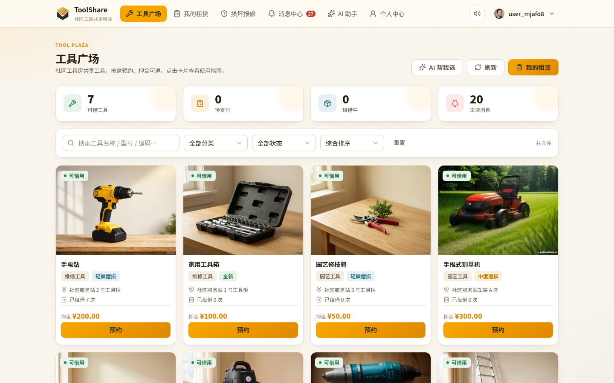
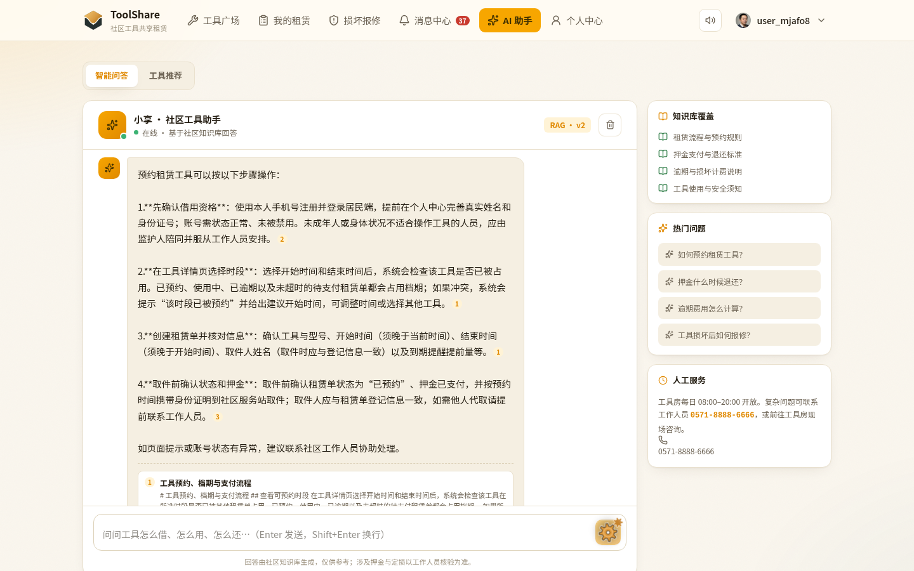
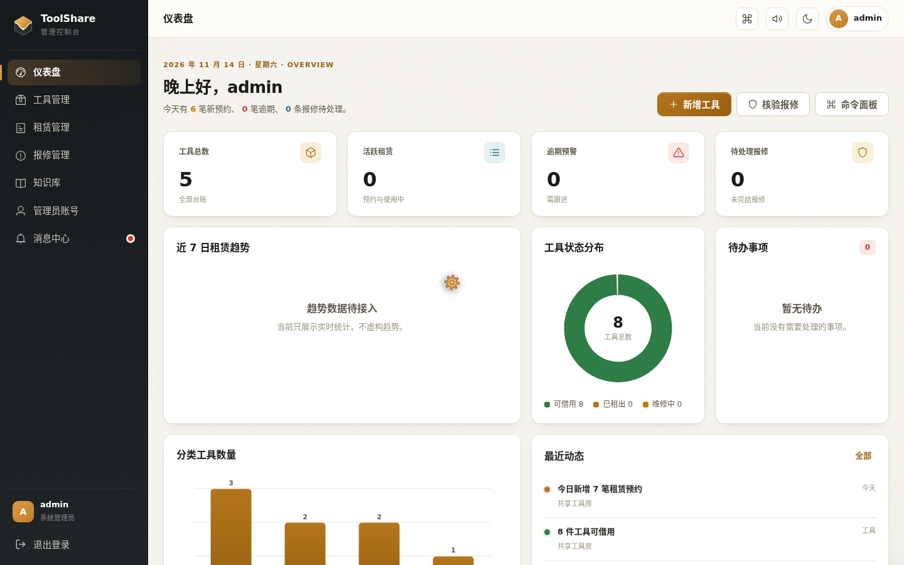
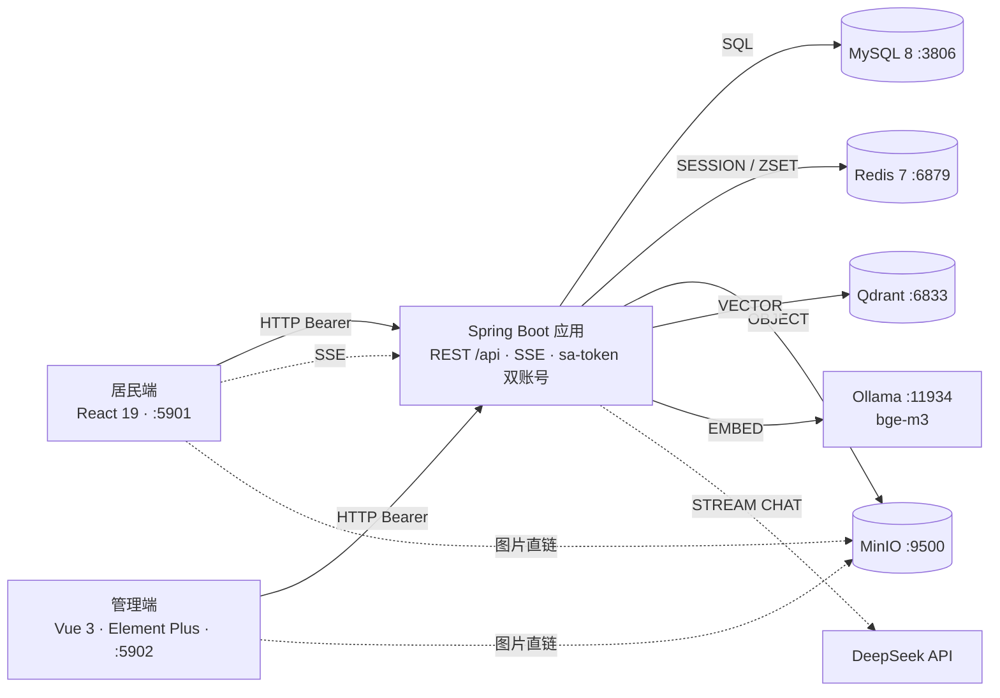
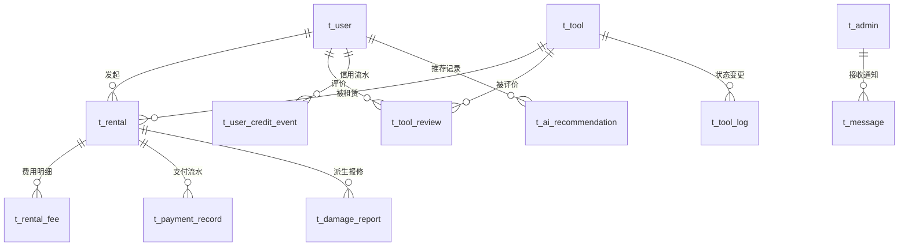

# ToolShare · 社区共享工具租赁系统

面向社区场景的工具共享租赁平台：居民按需预约、支付押金、取件使用、归还结算；工作人员处理取件、验收、报修与提醒。系统同时提供基于 RAG 的 AI 问答与工具推荐。

- **三类角色**：居民（USER）、工作人员（STAFF）、系统管理员（SUPER_ADMIN）
- **十个后端模块**：认证、工具、租赁与结算、损坏报修、消息、知识库、AI、统计、评价、信用分
- **两个独立前端**：居民端（React 19）、管理端（Vue 3 + Element Plus）
- **三项亮点**：评价 + 信用分；AI 引用溯源 + 评测集 + 反馈闭环；三条主流程 E2E + 一键验证


## 界面预览

| 居民端 · 登录 | 居民端 · 工具广场 |
| --- | --- |
|  |  |
| **AI 问答 · 引用溯源** | **管理端 · 仪表盘** |
|  |  |

## 快速开始

前置要求：JDK 21、Docker（含 Compose v2）、pnpm；运行 E2E 还需系统 Chrome。

```bash
# 1. 启动中间件（MySQL / Redis / MinIO / Qdrant / Ollama 等）
cp ops/.env.example ops/.env
cd ops && docker compose up -d && cd ..
# 首次会拉取 bge-m3；没有它 AI 检索会降级，不影响主流程

# 2. 启动后端（:8900）
#    ID_CARD_AES_KEY 缺失或长度不是 16/24/32 字节时拒绝启动
set -a; source ops/.env; set +a
./mvnw spring-boot:run
```

居民端（终端 A）：

```bash
cd frontend/web && pnpm install && pnpm dev      # http://localhost:5901
```

管理端（终端 B）：

```bash
cd frontend/admin && pnpm install && pnpm dev    # http://localhost:5902
```

后端启动时自动完成 Flyway 建表；空库时还会写入演示数据：执行 `src/main/resources/seed/demo-data.sql`、导入 `seed/knowledge/` 下的 28 篇文档、上传 `seed/images/` 下的工具图片与头像，并设置 MinIO 公开读策略。用 `TOOLSHARE_DEMO_SEED_ENABLED=false` 可关闭自动种子。

演示账号（密码均为 `Aa123456`）：

| 端 | 账号 | 角色 | 说明 |
| --- | --- | --- | --- |
| 管理端 `:5902` | `admin` | 系统管理员 | 可访问全部管理功能 |
| 居民端 `:5901` | `13800000001` | 居民 | 有密码，已完成实名 |
| 居民端 `:5901` | `13800000002` | 居民 | 无密码，仅验证码登录 |

工作人员账号由系统管理员在管理端创建并分配 `STAFF` 角色。验证码短信为 Mock：演示环境默认由接口直接返回验证码并自动填入；关闭 `toolshare.auth.expose-captcha` 后只写入日志 `[MOCK SMS]`。

## 核心亮点

### 评价 + 信用分

- 仅本人已归还的租赁单可评价，一单一评且不可修改；评分参与工具排序与推荐。
- 信用分初始 100，按规则事件加减并写入流水：按时归还 `+2`、逾期 `-3`、严重损坏 `-10`、收到 ≤2 星评价 `-5`，始终裁剪到 `0–100`。
- 居民可查看当前分值与每次变更原因，结果可解释、可追溯。

### AI 引用溯源 + 评测集 + 反馈闭环

- 问答先向量检索（Qdrant + Ollama `bge-m3`），异常或无命中时降级关键词检索；SSE 先发 `sources`，再流式发送回答。
- 回答附带 `[n]` 引用并展示来源标题与片段，居民可核对依据。
- 工具推荐保存推荐单，点击与「有帮助/没帮助」反馈写入 `t_ai_recommendation`；`degraded` 显式标识降级。
- 固定评测集 `docs/ai/eval/questions.json` 输出检索命中率与引用准确率，由独立脚本运行，不进入默认测试门禁。

### 主流程 E2E + 一键验证

- Playwright 串行覆盖三条真实流程：预约 → 支付 → 取件 → 归还；报修 → 核验 → 维修 → 验收；登录 → AI 问答（SSE 与来源片段）。
- `bash ops/verify.sh` 串联后端编译、测试、用户端 lint、双端构建与 E2E；任一环节失败立即停止。
- 集成测试使用 Testcontainers 自动启动 MySQL/Redis，MinIO 使用内存实现，Qdrant/Ollama/DeepSeek 全部隔离。

## 系统架构



1. **请求链路**：两个前端把 `/api` 代理到 `:8900`；统一响应 envelope 与语义化 HTTP 状态码。
2. **租赁与结算**：待支付 30 分钟未支付自动取消并释放档期；状态流转使用带状态条件的原子更新与版本号；押金、逾期费、损坏赔偿、退款写入费用明细与支付流水，金额只由服务端计算。
3. **定时任务**：待支付过期、取件/到期/逾期提醒、蹲守到货通知按单实例设计；Redis ZSet 保存到点提醒，消息行保证可查询与幂等。
4. **AI 链路**：知识库与工具向量写入 Qdrant；问答与推荐在检索失败、超时或无命中时降级关键词检索，外部模型不可用时仍返回完整事件流。
5. **对象存储**：上传图片经扩展名/MIME 白名单与重编码后写入 MinIO；公开桶直链由浏览器直接访问，`/api/files/**` 作为旧数据与策略失败时的兜底。

可交互的架构图、ER 图与时序图见 [docs/diagrams/](docs/diagrams/)；OpenAPI 契约见 [docs/api/openapi.json](docs/api/openapi.json)。

## 数据模型



迁移位于 `src/main/resources/db/migration/`，按域拆为 `V1__user_and_tool.sql` 至 `V4__review_credit_ai.sql`，全部是纯建表语句；演示数据在 `src/main/resources/seed/`，测试数据在 `src/test/resources/db/test-seed.sql`，均不进入 Flyway。完整字段以迁移脚本为准。

## 角色与模块

| 角色 | 入口 | 职责 |
| --- | --- | --- |
| 居民 `USER` | `frontend/web` | 浏览与预约工具、支付/取消、报修、消息、AI、评价与信用分 |
| 工作人员 `STAFF` | `frontend/admin` | 取件与归还验收、租赁查询导出、报修核验/维修/验收、消息与仪表盘 |
| 系统管理员 `SUPER_ADMIN` | `frontend/admin` | 工作人员全部能力，另含工具审核、知识库、管理员账号与渠道配置 |

| 模块 | 包 | 主要内容 |
| --- | --- | --- |
| 认证 | `module/auth` | 双账号登录、验证码频控、实名资料、管理员角色 |
| 工具 | `module/tool` | 台账与编码、状态机、审核工作流、可预约时段、蹲守、向量索引 |
| 租赁与结算 | `module/rental` | 状态机、档期冲突与并发控制、押金/费用/支付流水、提醒、Excel 导出 |
| 损坏报修 | `module/damage` | 报修状态机、核验、维修进度、验收、照片凭证 |
| 消息 | `module/message` | 站内消息、Mock 短信、送达状态、提醒偏好、幂等 |
| 知识库 | `module/knowledge` | 文档上传/解析/切块/索引状态 |
| AI | `module/ai` | RAG 问答（SSE）、引用溯源、降级检索、工具推荐与反馈 |
| 统计 | `module/dashboard` | 用户端与管理端真实统计 |
| 评价 | `module/review` | 已归还租赁单一单一评、评分汇总、图片与文字 |
| 信用分 | `module/credit` | 0–100 分值、规则事件与变更流水 |

跨模块公共能力在 `shared/`：统一响应与异常、分页、sa-token、MinIO 存储、身份证加密与脱敏、Redis 单号序列、HTML 净化、事务提交后副作用。

## 测试与验证

| 层级 | 位置 | 说明 |
| --- | --- | --- |
| 领域单元测试 | `src/test/java/.../module/**` | 状态机、结算与信用分规则、映射与工具类 |
| HTTP API 集成测试 | `src/test/java/.../service/**` | 权限、归属、校验、并发、结算流水、报修流程、上传安全 |
| 主流程 E2E | `ops/e2e/tests/**` | Playwright 串行覆盖三条真实前端流程 |
| AI 评测 | `src/test/java/.../eval/AiEvalTest.java` | `@Tag("ai-eval")`，默认门禁排除，由独立脚本运行 |

```bash
bash ops/verify.sh              # 编译 + 测试 + lint + 双端构建 + E2E
SKIP_E2E=1 bash ops/verify.sh   # 跳过 E2E
bash ops/ai-eval.sh             # AI 固定评测集，默认阈值 0.8
```

`ops/verify.sh` 会自行启动后端与两个前端，执行前需确保 `8900/5901/5902` 端口空闲、中间件已启动。不设覆盖率百分比门槛；以关键路径与领域不变量均有测试为准。AI 评测结果不纳入 `ops/verify.sh` 门禁。

## 部署与边界

- 统一启动、备份、日志、排障见 [`ops/README.md`](ops/README.md)。
- **单实例假设**（[ADR-0004](docs/adr/0004-single-instance-scheduling.md)）：`@Scheduled` 提醒、Redis 提醒队列与蹲守集合不适用于多副本。
- **无 CI/CD**（[ADR-0005](docs/adr/0005-no-ci-local-verification.md)）：合并门禁是本地 `bash ops/verify.sh` 全绿。
- **公开桶**（[ADR-0003](docs/adr/0003-public-bucket-upload-hardening.md)、[ADR-0008](docs/adr/0008-public-bucket-direct-urls.md)）：直链减少后端图片流量；图片重编码与类型白名单仍保留。生产必须把 `MINIO_PUBLIC_ENDPOINT` 配成浏览器可达地址。
- 生产需将两个前端的 `dist/` 由静态服务器托管，并把 `/api` 代理到 `:8900`；SSE 需关闭代理缓冲。

## 文档

- [需求文档 PRD](docs/PRD.md) · [附录（单据模板）](docs/附录.md)
- [领域词汇表](GLOSSARY.md) · [架构决策记录](docs/adr/)（ADR-0001 ~ ADR-0008）
- [部署与运维](ops/README.md) · [OpenAPI 契约](docs/api/openapi.json)
- [架构图](docs/diagrams/architecture.html) · [ER 图](docs/diagrams/er.html) · [时序图](docs/diagrams/sequence.html)
