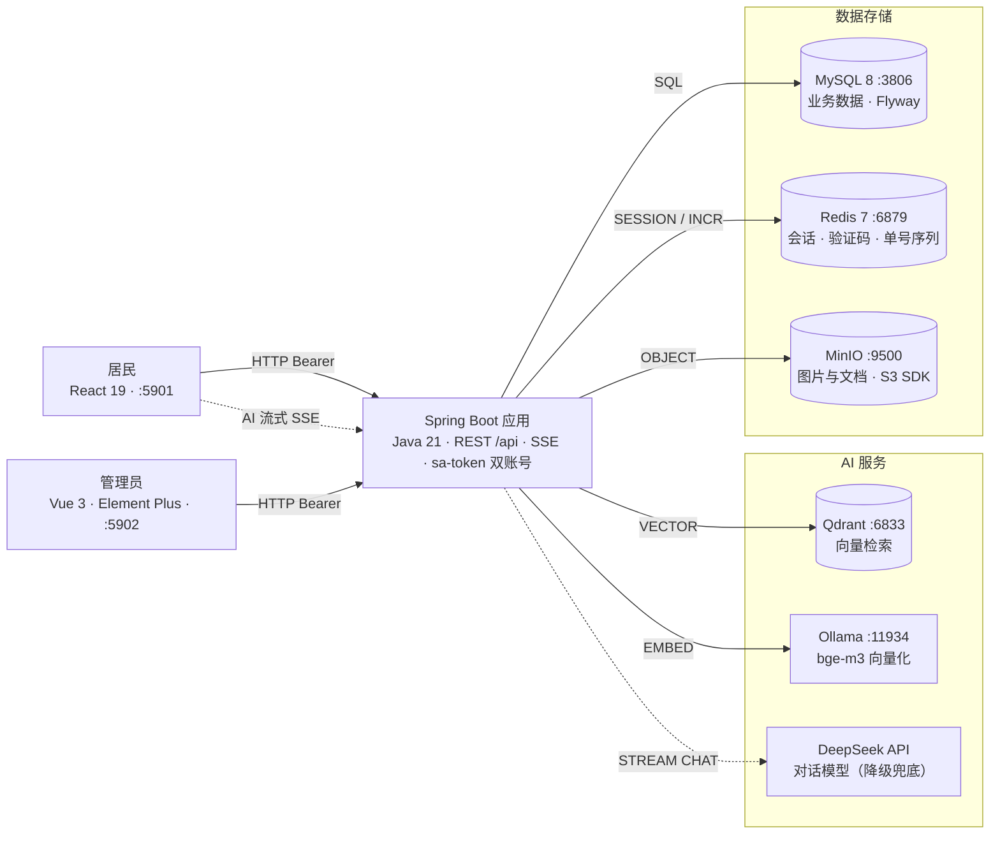
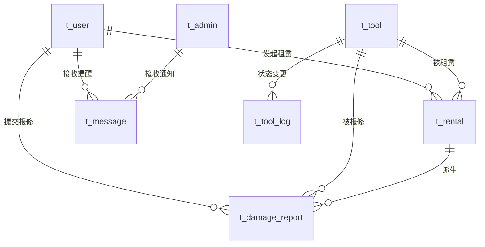

# ToolShare · 社区共享工具租赁系统


面向社区场景的工具共享租赁平台：解决居民日常工具「偶尔用、购买贵」的痛点，支持工具广场 → 租赁预约 → 取件归还 → 损坏报修 → 消息提醒全流程管理，并内置基于 RAG 的 AI 问答助手（SSE 流式输出）。

- **两类角色**：居民（USER） / 管理员（ADMIN，工作人员 + 系统管理员）
- **六大业务模块**：工具信息 · 租赁预约 · 租赁记录 · 损坏报修 · 消息提醒 · AI 问答

## 系统架构



可交互的架构图、ER 图与时序图见 [docs/diagrams/](docs/diagrams/)。

## 数据模型



完整字段与 DDL 见 `src/main/resources/db/migration/`（V1 schema + V2 seed）；可交互 ER 图见 [docs/diagrams/er.html](docs/diagrams/er.html)。

## 快速开始

前置要求：JDK 21 · pnpm · Docker（含 Compose）

```bash
# 1. 配置并启动中间件（MySQL/Redis/RabbitMQ/MinIO/Qdrant/Ollama，端口映射见 .env）
cp .env.example .env
docker compose up -d      # ollama-model-init 首次会拉取 bge-m3，耗时较长

# 2. 启动后端（:8900）
./mvnw spring-boot:run

# 3. 启动用户端（:5901）与管理端（:5902）
cd frontend/web && pnpm install && pnpm dev
cd frontend/admin && pnpm install && pnpm dev
```

初始化种子账号（密码均为 `Aa123456`）：

| 端 | 账号 | 说明 |
| --- | --- | --- |
| 管理端 `:5902` | `admin` | 管理员 |
| 用户端 `:5901` | `13800000001` | 居民（有密码） |
| 用户端 `:5901` | `13800000002` | 居民（无密码，仅验证码登录） |

用户端也支持手机号 + 验证码登录（短信为 MOCK，验证码在响应与日志 `[MOCK SMS]` 中）。

## 技术栈

**后端**（根目录，单 Maven 模块，按业务模块分包）

- Spring Boot 4.1 · Java 21 · Spring WebMVC（含 Reactor 流式）
- sa-token 双账号体系（`StpKit.USER` / `StpKit.ADMIN`，Bearer 头鉴权）
- MyBatis-Plus + Flyway（ORM 与数据库迁移 V1 schema + V2 seed）
- Spring AI：DeepSeek 对话（SSE 流式）+ Ollama bge-m3 向量化 + Qdrant 向量库（RAG，外部服务异常自动降级关键词检索）
- MinIO（对象存储，AWS S3 SDK）· EasyExcel（租赁记录导出）· Tika（知识库文档解析）· Hutool · Lombok

**前端**（两个独立 pnpm 项目）

- 用户端 `frontend/web`：React 19 + TypeScript + Vite + TanStack Query + zustand + Tailwind 4 + shadcn（`@base-ui/react`）+ fetch SSE 流式渲染
- 管理端 `frontend/admin`：Vue 3 + TypeScript + Vite + Element Plus + Pinia（持久化）+ Axios

**中间件**：MySQL 8 · Redis 7 · RabbitMQ 4（预留）· MinIO · Qdrant · Ollama

## 项目结构

```
tool-share/
├── frontend/
│   ├── web/                      # 用户端（React 19）
│   │   └── src/
│   │       ├── api/              # axios 接口层 + fetch SSE 客户端
│   │       ├── pages/            # 工具广场 / 我的租赁 / 损坏报修 / 消息 / AI / 个人中心
│   │       ├── components/ui/    # shadcn 风格基础组件（@base-ui/react）
│   │       └── stores/           # zustand（登录态持久化 localStorage）
│   └── admin/                    # 管理端（Vue 3）
│       └── src/
│           ├── api/              # 接口层（含 blob 下载）
│           └── views/            # 仪表盘 / 工具 / 租赁 / 报修 / 知识库 / 消息
├── src/main/
│   ├── java/com/cdwater/toolshare/
│   │   ├── shared/               # 跨模块基础设施
│   │   │   ├── web/              # 统一响应 Result、全局异常、PageVO
│   │   │   ├── config/           # sa-token 双账号、MyBatis-Plus、S3
│   │   │   ├── storage/          # MinIO 上传与公开读取
│   │   │   ├── security/         # 身份证 AES 加密与脱敏
│   │   │   └── sequence/         # Redis 单号序列（按库内最大值校准）
│   │   └── module/               # 业务模块（各自内聚 controller/service/entity/mapper/dto/vo）
│   │       ├── auth/             # 双账号登录、个人资料
│   │       ├── tool/             # 工具台账与状态日志
│   │       ├── rental/           # 租赁预约、取件归还、定时提醒、Excel 导出
│   │       ├── damage/           # 损坏报修：核验 / 维修进度 / 验收
│   │       ├── message/          # 消息提醒（biz_key 幂等去重）
│   │       ├── knowledge/        # 知识库文档与向量索引标记
│   │       ├── ai/               # RAG 检索 + SSE 流式问答
│   │       └── dashboard/        # 用户端 / 管理端统计
│   └── resources/db/migration/   # Flyway V1 schema + V2 seed
├── docs/                         # PRD、附录、diagrams/
└── docker-compose.yml            # 中间件编排
```

> 模块内部统一为 `controller / service / entity / mapper / dto / vo` 分层；跨模块仅依赖对方的 service / entity，公共能力一律走 `shared/`。

## 文档

- [需求文档 PRD](docs/PRD.md) · [附录（单据模板）](docs/附录.md)
- [架构图](docs/diagrams/architecture.html) · [ER 图](docs/diagrams/er.html) · [时序图](docs/diagrams/sequence.html)（浏览器直接打开）
