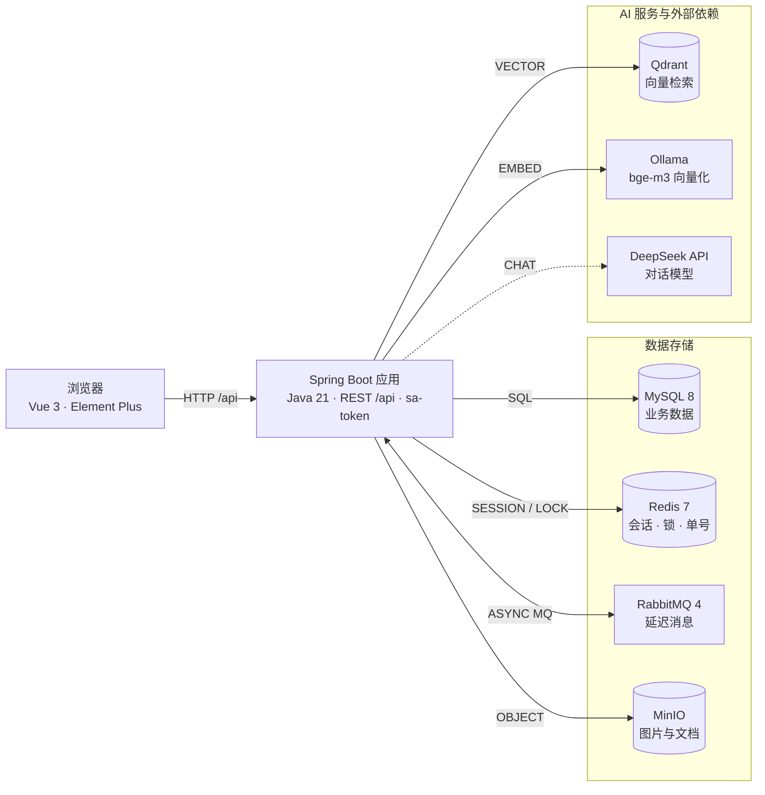
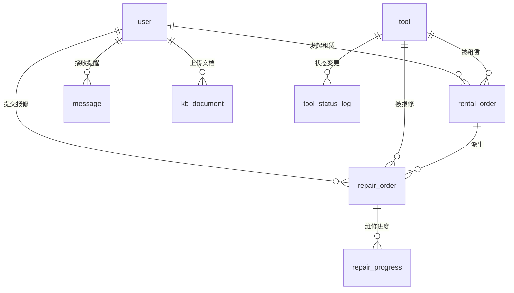

# Tool Share · 社区共享工具租赁系统


面向社区场景的工具共享租赁平台：解决居民日常工具「偶尔用、购买贵」的痛点，支持工具录入 → 租赁预约 → 取件归还 → 损坏报修 → 消息提醒全流程管理，并内置基于 RAG 的工具服务 AI 问答助手。

- **三级角色**：居民 / 社区工作人员 / 系统管理员
- **六大业务模块**：工具信息 · 租赁预约 · 租赁记录 · 损坏报修 · 消息提醒 · AI 问答

## 系统架构



## 数据模型



完整字段与 DDL 见 [docs/schema.sql](docs/schema.sql)；可交互的架构图与 ER 图见 [docs/diagrams/](docs/diagrams/)。

## 快速开始

前置要求：JDK 21 · pnpm · Docker（含 Compose）

```bash
# 1. 配置并启动中间件（MySQL/Redis/RabbitMQ/MinIO/Qdrant/Ollama）
cd deploy/docker && cp .env.example .env && cd ../..
make infra

# 2. 启动后端（:9090）
make backend

# 3. 启动前端（:5050）
make frontend
```

浏览器访问 <http://localhost:5050>，接口文档见 [docs/API.md](docs/API.md)。

初始化种子账号（密码均为 `Aa123456`）：

| 用户名 | 角色 |
| --- | --- |
| admin | 系统管理员 |
| lisi | 社区工作人员 |
| zhangsan | 居民 |

常用命令：

| 命令 | 说明 |
| --- | --- |
| `make up` / `make down` | 一键启动 / 停止（中间件 + 前后端） |
| `make infra` / `infra-down` / `infra-clean` | 中间件启停 / 清理数据卷 |
| `make logs` | 查看后端日志 |

## 技术栈

**后端**（根目录，单 Maven 模块）

- Spring Boot 4.1 · Java 21
- sa-token（认证鉴权，Redis 会话）
- MyBatis-Plus + Flyway（ORM 与数据库迁移）
- Redisson · RabbitMQ（延迟消息，用于提醒调度）
- Spring AI：DeepSeek 对话 + Ollama bge-m3 向量化 + Qdrant 向量库（RAG）
- MinIO（对象存储，AWS S3 SDK）· EasyExcel · MapStruct · Hutool · Lombok

**前端**（`frontend/`）

- Vue 3 + TypeScript + Vite
- Element Plus · Pinia（持久化）· Vue Router · Axios

**中间件**：MySQL 8 · Redis 7 · RabbitMQ 4 · MinIO · Qdrant · Ollama

## 项目结构

```
tool-share/
├── frontend/                     # 前端（Vue 3 + Vite）
│   └── src/
│       ├── api/                  # axios 接口层（按模块分文件 + TS 类型）
│       ├── views/                # 页面（login / tool / rental / repair / notify / ai / admin）
│       ├── layouts/              # 布局（侧边栏骨架）
│       ├── router/               # 路由与守卫（登录、角色分流）
│       └── stores/               # Pinia（登录态持久化）
├── src/main/
│   ├── java/com/cdwater/toolshare/
│   │   ├── common/               # 统一响应、全局异常、脱敏、单号生成
│   │   ├── config/               # sa-token、字段填充等基础设施配置
│   │   ├── user/                 # 用户与权限
│   │   ├── tool/                 # 工具信息
│   │   ├── rental/               # 租赁预约与记录
│   │   ├── repair/               # 损坏报修
│   │   ├── notify/               # 消息提醒
│   │   ├── ai/                   # RAG 知识库与问答
│   │   └── file/                 # 通用文件上传（MinIO）
│   └── resources/db/migration/   # Flyway 迁移脚本（含种子数据）
├── deploy/docker/                # 中间件 docker-compose 与环境变量
├── docs/                         # PRD、附录、API.md、演示原型 demo.html
└── Makefile                      # 一键启停
```

> 业务模块内部统一为 `controller / service / mapper / entity / dto / vo / converter` 分层；模块间只经 service 接口调用。

## 文档

- [开发环境准备](docs/SETUP.md)
- [需求文档 PRD](docs/PRD.md) · [附录（单据模板）](docs/附录.md)
- [接口文档 API.md](docs/API.md)
- [演示原型 demo.html](docs/demo.html)（浏览器直接打开）
