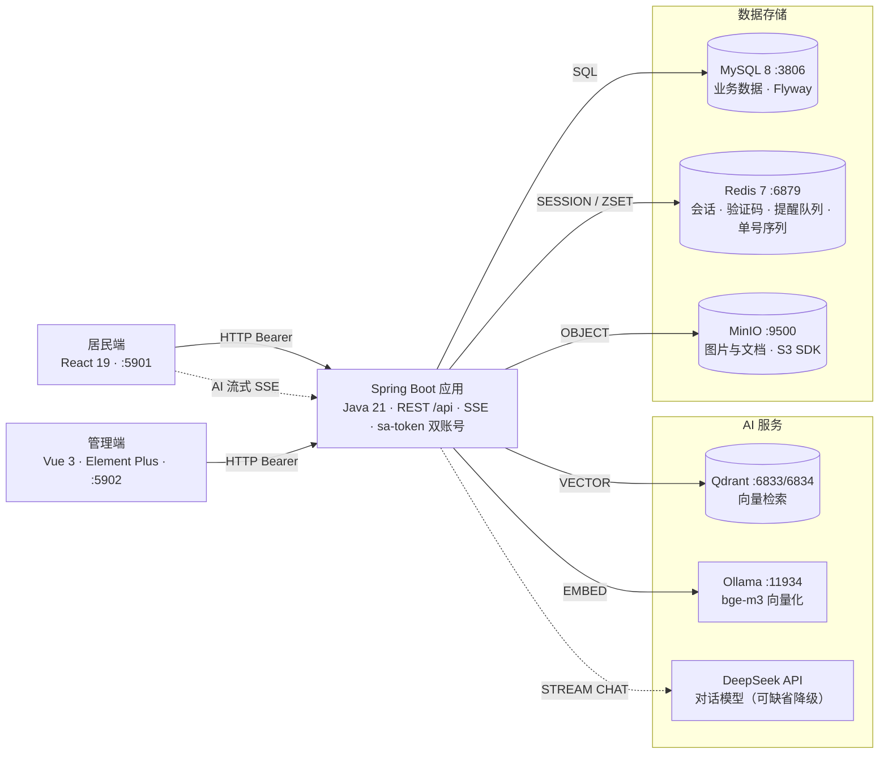
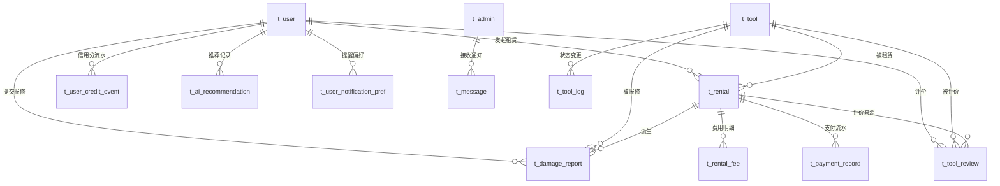

# ToolShare · 社区共享工具租赁系统


面向社区场景的工具共享租赁平台：解决居民日常工具「偶尔用、购买贵」的痛点。系统覆盖工具广场与可预约时段 → 创建租赁单 → 押金支付 → 取件 → 归还结算，以及损坏报修、消息提醒、评价与信用分、AI 问答和工具推荐。

- **三类角色**：居民（USER）、工作人员（STAFF）、系统管理员（SUPER_ADMIN）
- **十个后端业务模块**：认证、工具、租赁与结算、损坏报修、消息提醒、知识库、AI、统计、评价、信用分
- **两个独立前端**：居民端（React 19）、管理端（Vue 3 + Element Plus）
- **三项亮点**：评价 + 信用分；AI 引用溯源 + 固定评测集 + 推荐反馈闭环；三条主流程 E2E + 一键验证

## 角色与权限

| 角色 | 入口 | 职责 |
| --- | --- | --- |
| 居民 `USER` | `frontend/web` | 浏览与搜索工具、查看可预约时段、创建/支付/取消租赁单、报修与上传凭证、查看消息与提醒偏好、AI 问答与推荐、评价、信用分 |
| 工作人员 `STAFF` | `frontend/admin` | 取件与归还验收、租赁单查询与导出、报修核验/维修进度/验收、管理端消息、仪表盘 |
| 系统管理员 `SUPER_ADMIN` | `frontend/admin` | 工作人员全部能力，另含工具台账与审核、知识库、管理员账号与渠道配置 |

- 用户端与管理端使用 sa-token 两套独立账号体系，token 不得混用。
- 管理员角色与权限集合见 `shared/enums/AdminRole.java`；工作人员不能访问工具、知识库和管理员管理接口。
- 居民数据按归属校验；身份证以 AES/GCM 加密存储，接口返回脱敏值。

## 业务模块

| 模块 | 包 | 主要内容 |
| --- | --- | --- |
| 认证 | `module/auth` | 双账号登录、验证码频控、实名资料、管理员角色 |
| 工具 | `module/tool` | 工具台账与编码、状态机、审核工作流、可预约时段、蹲守、向量索引 |
| 租赁与结算 | `module/rental` | 租赁状态机、档期冲突与并发控制、押金/费用/支付流水、提醒调度、Excel 导出 |
| 损坏报修 | `module/damage` | 报修状态机、核验、维修进度、验收、照片凭证 |
| 消息 | `module/message` | 站内消息、Mock 短信、送达状态、提醒偏好、`biz_key` 幂等 |
| 知识库 | `module/knowledge` | 文档上传/解析/切块/索引状态 |
| AI | `module/ai` | RAG 问答（SSE）、引用溯源、降级检索、工具推荐、点击与反馈 |
| 统计 | `module/dashboard` | 用户端与管理端真实统计 |
| 评价 | `module/review` | 已归还租赁单一单一评、评分汇总、图片与文字 |
| 信用分 | `module/credit` | 0–100 分值、规则事件与变更流水 |

跨模块公共能力在 `shared/`：统一响应与异常、分页、sa-token 配置、MinIO 存储、身份证加密/脱敏、Redis 单号序列、HTML 净化、事务提交后副作用等。

> 本仓库是渐进式重构（[ADR-0001](docs/adr/0001-incremental-refactor.md)）的最终形态：旧模块实现、旧接口、旧错误处理与前端手写枚举已删除；前端类型来自 `docs/api/openapi.json` 的契约生成结果。

## 三项亮点

### 1. 评价 + 信用分

- 仅本人已归还的租赁单可评价，一单一评且不可修改；评分进入工具评分与推荐排序。
- 信用分初始 100，按规则事件加减并写入流水：按时归还 `+2`、逾期归还 `-3`、严重损坏 `-10`、收到 ≤2 星评价 `-5`，始终裁剪到 `0–100`。
- 居民可查看当前分值与每次变更原因，现场可解释、可追溯。

### 2. AI 引用溯源 + 评测集 + 反馈闭环

- 问答先向量检索（Qdrant + Ollama `bge-m3`），异常或为空时自动降级为关键词检索；SSE 先发 `sources` 事件，再流式发送回答。
- 回答附加 `[n]` 引用并展示来源标题与片段，居民可核对依据。
- 工具推荐记录每次召回的推荐单；点击与「有帮助/没帮助」反馈写入 `t_ai_recommendation`，`degraded` 字段显式标识降级。
- 固定评测集 `docs/ai/eval/questions.json` 输出检索命中率与引用准确率，作为独立脚本运行，不进入默认测试门禁。

### 3. 主流程 E2E + 一键验证

- Playwright 串行覆盖三条主流程：预约 → 支付 → 取件 → 归还；报修 → 核验 → 维修 → 验收；登录 → AI 问答（SSE 与来源片段）。
- `bash ops/verify.sh` 串联后端编译、单元/集成测试、用户端 lint + 双端构建与 E2E；任一环节失败立即停止并打印失败步骤。
- 集成测试通过 Testcontainers 自动启动 MySQL/Redis，MinIO 使用内存实现，Qdrant/Ollama/DeepSeek 全部隔离，无需手动准备环境。

## 系统架构



数据流要点：

1. **请求链路**：两个 Vite 前端把 `/api` 代理到 `http://localhost:8900`；后端按模块分发，统一响应 envelope + 语义化 HTTP 状态码。
2. **租赁与结算**：创建租赁单即占档，待支付 30 分钟未支付自动取消并释放档期；状态流转使用带状态条件的原子更新与版本号。押金、逾期费、损坏赔偿、退款写入 `t_rental_fee` / `t_payment_record`，金额只由服务端计算。
3. **定时任务**：过期待支付、取件/到期/逾期提醒、蹲守到货通知按单实例设计；Redis ZSet 保存到点提醒，数据库消息行保证可查询与幂等。
4. **AI 链路**：知识库与工具向量写入 Qdrant；问答与推荐在向量检索失败、超时或无命中时降级关键词检索，外部模型不可用时仍返回完整事件流或降级推荐。
5. **对象存储**：上传图片经扩展名/MIME 白名单与重编码后写入 MinIO；公开桶直链由浏览器直接访问，`/api/files/**` 作为旧数据与策略失败时的代理兜底。

可交互的架构图、ER 图与时序图见 [docs/diagrams/](docs/diagrams/)。OpenAPI 契约快照见 [docs/api/openapi.json](docs/api/openapi.json)。

> RabbitMQ 4 仍由 `ops/docker-compose.yml` 启动并在 `.env.example` 中保留凭据，但当前代码未接入 AMQP（预留组件）。

## 数据模型



- 基础表：`t_user`、`t_admin`、`t_tool`、`t_rental`、`t_damage_report`、`t_message`、`t_tool_log`、`t_knowledge_doc`。
- 重构新增：`t_rental_fee`、`t_payment_record`、`t_tool_review`、`t_user_credit_event`、`t_ai_recommendation`、`t_user_notification_pref`、`t_message_config`，以及租赁快照、版本号、管理员角色、工具审核等增量列。
- 迁移位于 `src/main/resources/db/migration/`，按域拆为 `V1__user_and_tool.sql`、`V2__rental_and_damage.sql`、`V3__message_and_knowledge.sql`、`V4__review_credit_ai.sql`，全部是纯建表语句（含最终列与索引）；演示数据在 `src/main/resources/seed/`（SQL、知识库语料、工具图片），测试数据在 `src/test/resources/db/test-seed.sql`，都不进入 Flyway。完整字段以迁移脚本为准，可交互 ER 图见 [docs/diagrams/er.html](docs/diagrams/er.html)。

## 目录结构

```text
tool-share/
├── frontend/
│   ├── web/                        # 居民端（React 19 + TypeScript + Vite）
│   │   └── src/
│   │       ├── api/                # 接口层 + OpenAPI 生成类型 + SSE 客户端
│   │       ├── pages/              # 工具广场 / 我的租赁 / 报修 / 消息 / AI / 个人中心
│   │       ├── layouts/ hooks/ lib/ stores/
│   │       └── components/
│   └── admin/                      # 管理端（Vue 3 + Element Plus + Pinia）
│       └── src/
│           ├── api/                # 接口层 + 契约生成类型（含 blob 下载）
│           ├── views/              # 仪表盘 / 工具 / 租赁 / 报修 / 知识库 / 消息 / 账号
│           └── router/ stores/ utils/
├── src/main/
│   ├── java/com/cdwater/toolshare/
│   │   ├── shared/                 # 跨模块基础设施
│   │   │   ├── web/                # 统一响应、异常、分页
│   │   │   ├── config/             # sa-token 双账号、MyBatis-Plus、S3
│   │   │   ├── storage/            # MinIO 上传、图片校验与公开读取
│   │   │   ├── security/           # 身份证 AES/GCM 加密、脱敏、启动迁移
│   │   │   ├── sequence/           # Redis 单号序列（按库内最大值校准）
│   │   │   ├── enums/ html/ tx/ validation/
│   │   └── module/                 # 业务模块，各自内聚 controller/service/entity/mapper/dto/vo
│   │       ├── auth/ tool/ rental/ damage/ message/
│   │       └── knowledge/ ai/ dashboard/ review/ credit/
│   └── resources/
│       ├── application.yml
│       ├── db/migration/           # Flyway 迁移
│       └── seed/                   # 初始化数据：SQL、知识库语料、工具图片
├── src/test/java/                  # 单元 + HTTP API 集成测试 + AI 评测
├── docs/
│   ├── PRD.md  附录.md
│   ├── adr/                        # ADR-0001 ~ ADR-0007
│   ├── agents/                     # 仓库内文档消费约定
│   ├── api/openapi.json            # OpenAPI 契约快照
│   ├── ai/eval/questions.json      # AI 固定评测集
│   └── diagrams/                   # 架构 / ER / 时序图（HTML）
├── ops/                            # 部署与运维入口（见 ops/README.md）
│   ├── docker-compose.yml
│   ├── .env.example
│   ├── verify.sh
│   ├── e2e.sh  e2e/                # Playwright 主流程 E2E
│   └── ai-eval.sh
├── GLOSSARY.md
└── README.md
```

## 快速开始

前置要求：JDK 21、Docker（含 Compose v2）、pnpm；运行 E2E 还需系统安装 Google Chrome（Playwright 使用 `channel: "chrome"`，不额外下载浏览器）。

```bash
# 1. 准备环境变量并启动中间件
cp ops/.env.example ops/.env
cd ops && docker compose up -d && cd ..
# ollama-model-init 首次会拉取 bge-m3，耗时较长；没有它 AI 检索会降级

# 2. 启动后端（:8900）
#    ID_CARD_AES_KEY 无默认值，缺失或长度不是 16/24/32 字节时后端拒绝启动
set -a; source ops/.env; set +a
./mvnw spring-boot:run

# 3. 另开终端，启动两个前端
cd frontend/web && pnpm install && pnpm dev      # http://localhost:5901
cd frontend/admin && pnpm install && pnpm dev    # http://localhost:5902
```

首次启动后端会自动建表，并在空库时自动写入演示数据：执行 `src/main/resources/seed/demo-data.sql`、导入 `seed/knowledge/` 下的 28 篇知识库文档、上传 `seed/images/` 下的工具图片。无需手工执行 SQL；用 `TOOLSHARE_DEMO_SEED_ENABLED=false`（对应 `toolshare.demo.seed-enabled`）可关闭自动种子。

如果关闭了自动种子但仍需要演示数据，可手工执行：

```bash
set -a; source ops/.env; set +a
docker compose -f ops/docker-compose.yml exec -T mysql \
  mysql --default-character-set=utf8mb4 -uroot -p"$MYSQL_ROOT_PASSWORD" "$MYSQL_DATABASE" < src/main/resources/seed/demo-data.sql
```

`ops/e2e.sh` 会等待启动种子完成后再运行 Playwright。

演示账号（密码均为 `Aa123456`）：

| 端 | 账号 | 角色 | 说明 |
| --- | --- | --- | --- |
| 管理端 `:5902` | `admin` | 系统管理员 | 由 `src/main/resources/seed/demo-data.sql` 写入，角色 `SUPER_ADMIN` |
| 居民端 `:5901` | `13800000001` | 居民 | 有密码，已完成实名 |
| 居民端 `:5901` | `13800000002` | 居民 | 无密码，仅验证码登录 |

工作人员账号需由系统管理员在管理端创建并分配 `STAFF` 角色。验证码短信为 Mock：课程演示环境默认由接口直接返回 6 位验证码并自动填入登录表单；关闭 `toolshare.auth.expose-captcha` 后接口只返回 `null`，验证码写入日志 `[MOCK SMS]`。接入真实短信或对外部署前必须关闭该开关。

### 验证与 AI 评测

```bash
# 全量验证：后端编译 + 测试 + 用户端 lint + 双端构建 + 三条主流程 E2E
bash ops/verify.sh

# 跳过 E2E（只跑编译、测试与前端构建）
SKIP_E2E=1 bash ops/verify.sh

# AI 固定评测集：输出检索命中率与引用准确率，默认阈值 0.8
bash ops/ai-eval.sh
```

`ops/verify.sh` 会自己启动后端与两个前端 dev server，因此执行前需确保 `8900/5901/5902` 端口空闲，且中间件已启动、`ops/.env` 存在。E2E 失败时日志保留在临时目录（脚本会打印路径）。

## 测试策略

| 层级 | 位置 | 说明 |
| --- | --- | --- |
| 领域单元测试 | `src/test/java/.../module/**` | 租赁/工具/报修状态机、结算与信用分规则、映射与工具类 |
| HTTP API 集成测试 | `src/test/java/.../service/**` | 通过控制器验证权限、归属、校验、并发、结算流水、报修流程、上传安全等；Testcontainers 启动 MySQL/Redis，MinIO 内存实现，外部 AI 全部排除 |
| 主流程 E2E | `ops/e2e/tests/**` | Playwright 串行执行三条真实前端流程，验证跨层接线 |
| AI 评测 | `src/test/java/.../eval/AiEvalTest.java` | `@Tag("ai-eval")`，默认测试门禁排除；`ops/ai-eval.sh` 单独运行 |

不设覆盖率百分比门槛；以关键路径与领域不变量均有测试为准。AI 评测结果不纳入 `ops/verify.sh` 门禁。

## 环境变量

`ops/.env.example` 是本地模板，复制为 `ops/.env` 后由 `source` 注入后端进程。Compose 与 Spring Boot 共用同一批中间件变量。

### 必填 / 中间件

| 变量 | 默认模板值 | 说明 |
| --- | --- | --- |
| `MYSQL_ROOT_PASSWORD` | `toolmysql` | MySQL root 密码 |
| `MYSQL_DATABASE` | `tool_share` | 数据库名 |
| `REDIS_PASSWORD` | `toolredis` | Redis 密码 |
| `MINIO_ROOT_USER` / `MINIO_ROOT_PASSWORD` | `toolminio` | MinIO 账号，同时作为应用 S3 凭据 |
| `QDRANT_API_KEY` | `toolqdrant` | Qdrant API Key |
| `RABBITMQ_DEFAULT_USER` / `RABBITMQ_DEFAULT_PASS` | `toolrabbitmq` | 预留组件凭据，当前业务未使用 |
| `ID_CARD_AES_KEY` | 示例值 | **必填**，16/24/32 字节；无默认值，缺失会拒绝启动。生成示例：`openssl rand -hex 16` |

### AI 与连接地址（可选覆盖）

| 变量 | 默认值 | 说明 |
| --- | --- | --- |
| `DEEPSEEK_API_KEY` | 空 | 留空或调用失败时 AI 问答走兜底回答、推荐走降级路径 |
| `DEEPSEEK_BASE_URL` | `https://api.deepseek.com` | OpenAI 兼容地址 |
| `DEEPSEEK_CHAT_MODEL` | `deepseek-v4-flash` | 对话模型 |
| `OLLAMA_BASE_URL` | `http://localhost:11934/v1` | 向量化服务 |
| `QDRANT_HOST` | `localhost` | Qdrant gRPC 主机（端口固定 `6834`） |
| `MINIO_ENDPOINT` | `http://localhost:9500` | 后端 S3 客户端使用的 MinIO 地址 |
| `MINIO_PUBLIC_ENDPOINT` | `http://localhost:9500` | 浏览器直连对象使用的地址，生产环境设为公开域名或反向代理 |
| `MINIO_BUCKET` | `tool-share` | 桶名，首次使用时自动创建并设置公开读 |

### 业务开关（`application.yml` 中的 `toolshare.*`）

| 配置 | 默认 | 说明 |
| --- | --- | --- |
| `toolshare.auth.expose-captcha` | `true` | Mock 短信演示默认直接返回验证码；接入真实短信或对外部署前改为 `false` |
| `toolshare.auth.rate-limit.*` | 1/分钟、5/小时、10/IP/小时 | 验证码频控 |
| `toolshare.message.sms-enabled` | `false` | Mock 短信渠道开关 |
| `toolshare.message.default-channel` | `SYSTEM` | 未设置偏好时的默认渠道 |
| `toolshare.rental.pending-payment-timeout-minutes` | `30` | 待支付超时自动取消 |
| `toolshare.rental.default-remind-minutes` | `1440` | 默认到期提醒提前量 |
| `toolshare.availability.slot-minutes` | `30` | 可预约时段粒度 |
| `toolshare.ai.recommend.top-k` / `max-results` | `20` / `5` | 向量召回与返回上限 |
| `toolshare.ai.recommend.index-on-startup` | `true` | 启动时重建工具向量索引 |

Spring Boot 支持用环境变量覆盖这些配置，例如对外部署时设置 `TOOLSHARE_AUTH_EXPOSE_CAPTCHA=false`。

## 部署与运维

- 统一入口：[`ops/README.md`](ops/README.md)（启动/停止、环境变量、备份、日志、单实例限制、故障排查）。
- **单实例部署假设**（[ADR-0004](docs/adr/0004-single-instance-scheduling.md)）：`@Scheduled` 提醒任务、Redis 提醒队列与蹲守集合不适用于多副本，横向扩容前必须重新设计。
- **无 CI/CD**（[ADR-0005](docs/adr/0005-no-ci-local-verification.md)）：合并门禁是本地 `bash ops/verify.sh` 全绿，仓库不维护流水线配置。
- **备份**：MySQL 与 MinIO 是必须备份的数据源；Redis 会话可丢失，Qdrant 索引与 Ollama 模型可重建。具体命令见 `ops/README.md`。
- **文件公开桶**（[ADR-0003](docs/adr/0003-public-bucket-upload-hardening.md)、[ADR-0008](docs/adr/0008-public-bucket-direct-urls.md)）：公开桶直链减少后端图片流量；仍通过类型白名单与图片重编码消除 XSS，`/api/files/**` 仅作兜底。如后续有隐私要求，升级为私有桶 + 签名 URL。
- 仓库未包含生产反向代理配置；生产部署需将两个前端的 `dist/` 由静态服务器托管，并把 `/api` 代理到 `:8900`（SSE 需关闭代理缓冲）。

## PRD 范围裁剪

以下 PRD 条目明确不做或由部署层承担，详细理由见 [ADR-0006](docs/adr/0006-prd-scope-cuts.md)：

- 财务数据字段级加密：由部署层 HTTPS 承担。
- 数据库备份策略的代码实现：写入运维文档，不写代码。
- 与居民信息系统对接：PRD 可选，明确不做。
- 视频报修：仅支持 1–3 张图片。
- 多实例部署与分布式调度锁、CI/CD 流水线：分别见 ADR-0004 / ADR-0005。
- 管理员操作审计日志：仅实现角色权限，不新增审计表。
- 前端视觉重新设计、覆盖率数字指标：不在范围内。

## 文档

- [需求文档 PRD](docs/PRD.md) · [附录（单据模板）](docs/附录.md)
- [领域词汇表 GLOSSARY.md](GLOSSARY.md)
- [架构决策记录 ADR](docs/adr/)（0001 渐进式重构 · 0002 结算流水 · 0003 公开桶加固 · 0004 单实例调度 · 0005 无 CI · 0006 PRD 裁剪 · 0007 AI 降级与评测 · 0008 公开桶直链）
- [部署与运维 ops/README.md](ops/README.md)
- [架构图](docs/diagrams/architecture.html) · [ER 图](docs/diagrams/er.html) · [时序图](docs/diagrams/sequence.html)（浏览器直接打开）
- [OpenAPI 契约](docs/api/openapi.json)
