# 社区共享工具租赁系统用户操作手册

## 1. 手册说明

### 1.1 适用对象

- 居民：使用居民端浏览工具、预约、支付、报修、查看消息与使用 AI 助手。
- 社区工作人员：使用管理端处理取件、归还、报修、消息与统计。
- 系统管理员：在工作人员能力之外管理工具、知识库和管理员账号。

### 1.2 访问地址

| 端 | 地址 |
| --- | --- |
| 居民端 | `http://localhost:5901` |
| 管理端 | `http://localhost:5902` |
| 后端 API | `http://localhost:8900` |

### 1.3 演示账号

| 端 | 账号 | 密码 | 说明 |
| --- | --- | --- | --- |
| 管理端 | `admin` | `Aa123456` | 系统管理员 |
| 居民端 | `13800000001` | `Aa123456` | 已完成实名的居民 |
| 居民端 | `13800000002` | 无 | 仅验证码登录 |

验证码为 Mock：演示环境发送后会在页面提示验证码并自动填入；关闭验证码返回开关后，验证码只写入后端日志 `[MOCK SMS]`。

## 2. 居民端操作

### 2.1 登录

1. 打开 `http://localhost:5901/login`。
2. 选择「验证码登录」或「密码登录」。
3. 验证码登录：输入手机号，点击「获取验证码」，输入 6 位验证码后点击「启动工坊」。
4. 密码登录：输入手机号和密码后点击「启动工坊」。
5. 登录成功后进入工具广场。

> 首次使用验证码登录会自动创建居民账号；预约前需要在个人中心完善真实姓名和身份证号。

### 2.2 浏览与筛选工具

1. 在工具广场查看可借工具数量、待支付、租借中与未读消息。
2. 使用搜索框输入工具名称、型号或编码。
3. 使用「全部分类」「全部状态」「综合排序」筛选。
4. 点击工具卡片查看详情。

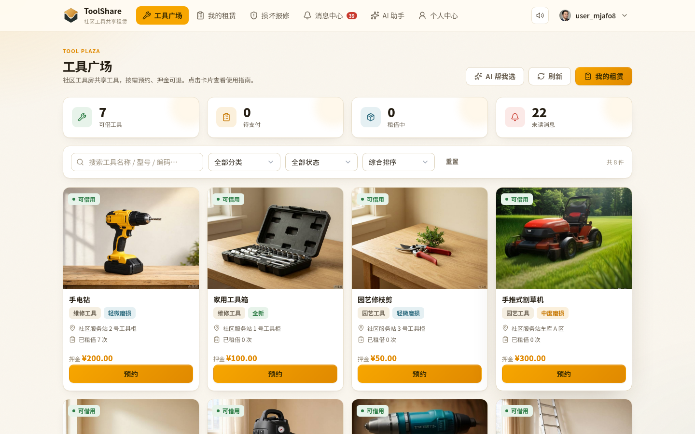

工具详情包含：

- 工具名称、编码、型号、类别与损坏程度；
- 押金、租赁次数、用户评分与存放区域；
- 图文使用说明；
- 最近租赁摘要；
- 「立即预约」按钮。

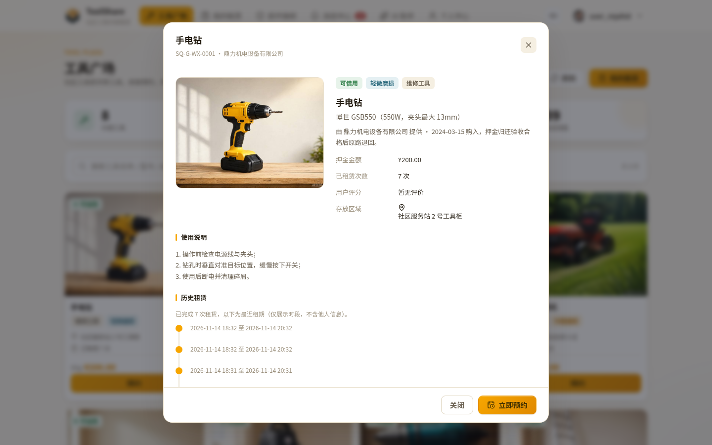

### 2.3 预约工具

1. 在工具详情点击「立即预约」。
2. 选择开始时间与结束时间。开始时间必须晚于当前时间，结束时间必须晚于开始时间。
3. 系统实时校验档期：显示「该时段可预约」时可继续；冲突时会提示建议时间。
4. 填写取件人姓名，选择到期提醒提前量。
5. 点击「提交预约」，生成租赁单并进入「我的租赁」。

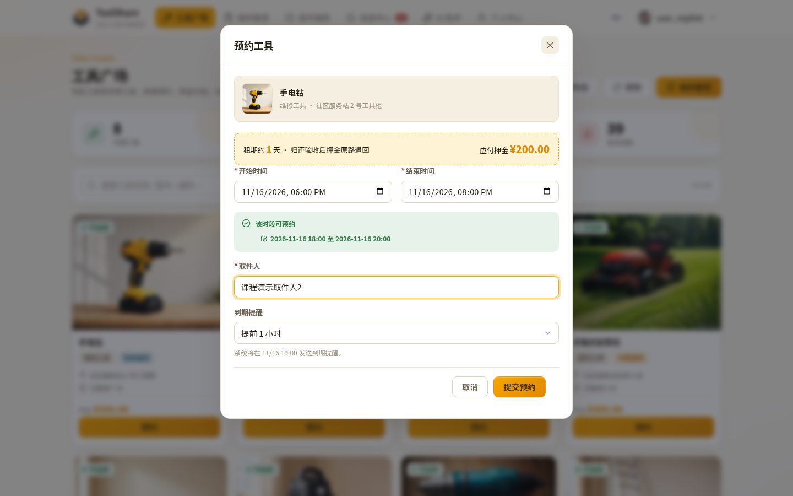

> 待支付租赁单会占用档期；创建后 30 分钟内未支付会自动取消。

### 2.4 支付押金

1. 在「我的租赁」找到待支付租赁单。
2. 点击「去支付」。
3. 核对押金金额与支付方式（微信支付 / 支付宝 / 社区余额）。
4. 点击「确认支付」。支付成功后租赁单状态变为「已预约」。

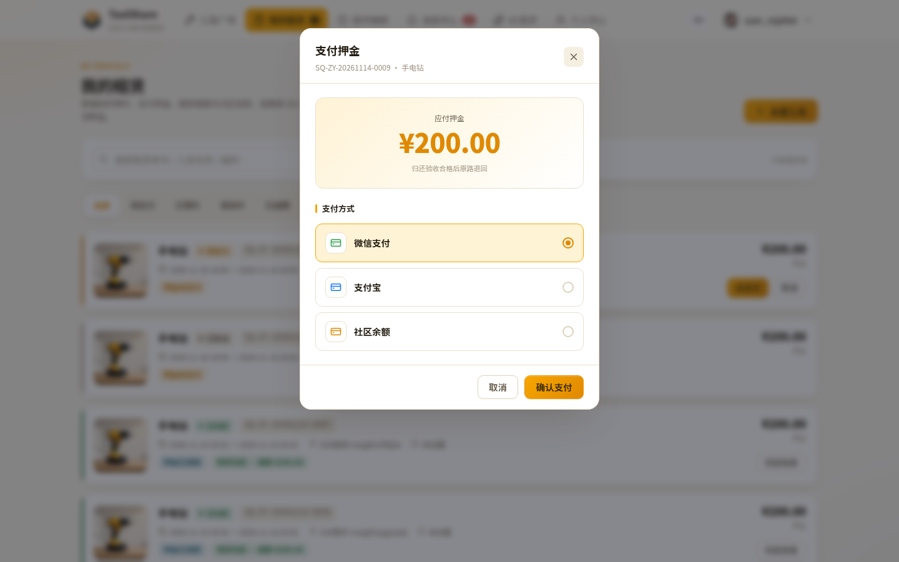

### 2.5 我的租赁

「我的租赁」支持按状态筛选：全部、待支付、已预约、使用中、已逾期、已归还、已取消。

- 待支付：可支付或取消。
- 已预约：取件前 24 小时外可取消；已支付押金按规则退回。
- 使用中 / 已逾期：查看租期与逾期提示，及时归还。
- 已归还：查看验收结果、费用明细、支付流水与退款金额。

> 取件前不足 24 小时需要取消时，请联系社区工作人员处理。

### 2.6 损坏报修

1. 进入「损坏报修」，点击「发起报修」。
2. 选择使用中或逾期的租赁单。
3. 填写损坏部位、损坏经过与当前状态。
4. 上传 1–3 张能看清损坏位置的照片。
5. 提交后生成报修单，可在列表中查看核验、维修、验收进度。

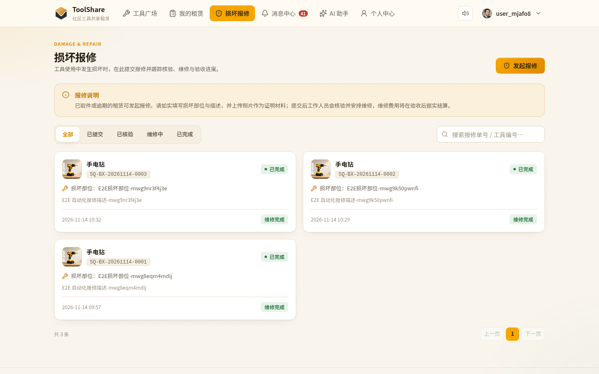

> 不要自行拆修或隐瞒损坏；存在未处理报修时，归还流程需要先完成报修核验与验收。

### 2.7 消息中心

1. 进入「消息中心」查看预约、支付、取件、到期、逾期、报修与系统消息。
2. 使用类型标签筛选当前页消息。
3. 点击消息可标记已读；也可点击「全部已读」。
4. 未读数量会显示在顶部导航角标。

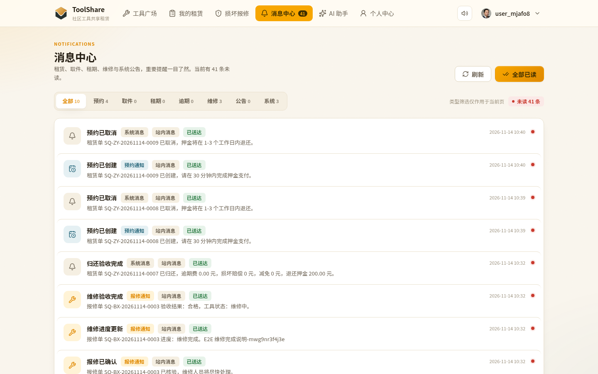

消息记录包含渠道、送达状态与时间。Mock 短信的送达状态仅用于演示，不代表真实短信已到达手机。

### 2.8 AI 助手

1. 进入「AI 助手」。
2. 在输入框输入问题，例如「如何预约租赁工具？」。
3. 按 Enter 发送，回答会流式显示。
4. 回答中的 `[n]` 可点击定位到下方知识库来源。
5. 可在右侧查看知识库覆盖范围与热门问题。

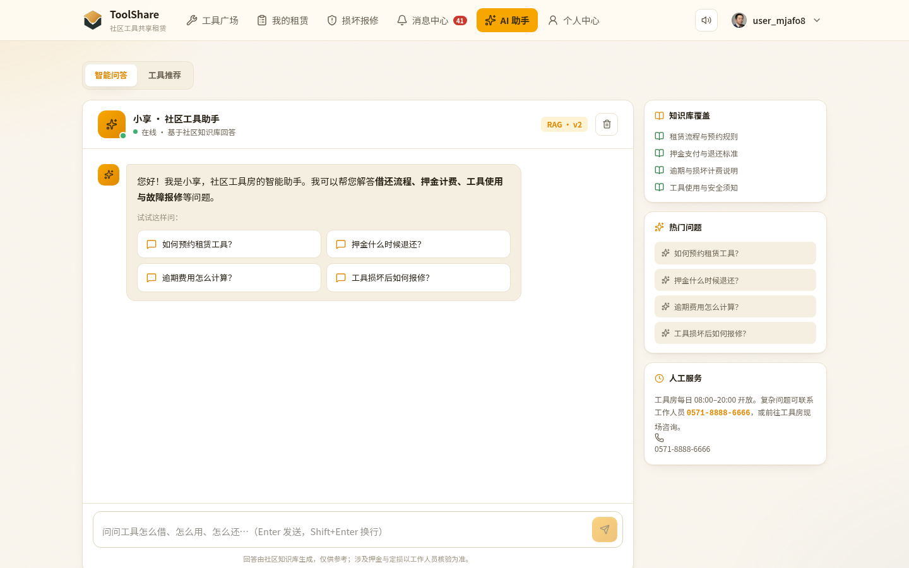

> AI 回答基于社区知识库，仅作参考；押金、赔偿等以工作人员核验为准。外部模型不可用时系统会降级为知识库检索与兜底回答，不影响主流程。

### 2.9 个人中心

1. 进入「个人中心」查看昵称、手机号、实名状态、资料完整度、累计租借与信用分。
2. 点击头像右下角按钮上传新头像。
3. 修改昵称、真实姓名、身份证号，点击「保存资料」。
4. 在「偏好设置」中开启或关闭预约、取件、到期、逾期、报修、蹲守等提醒。
5. 在「租赁评价」中对已归还租赁单进行评价。

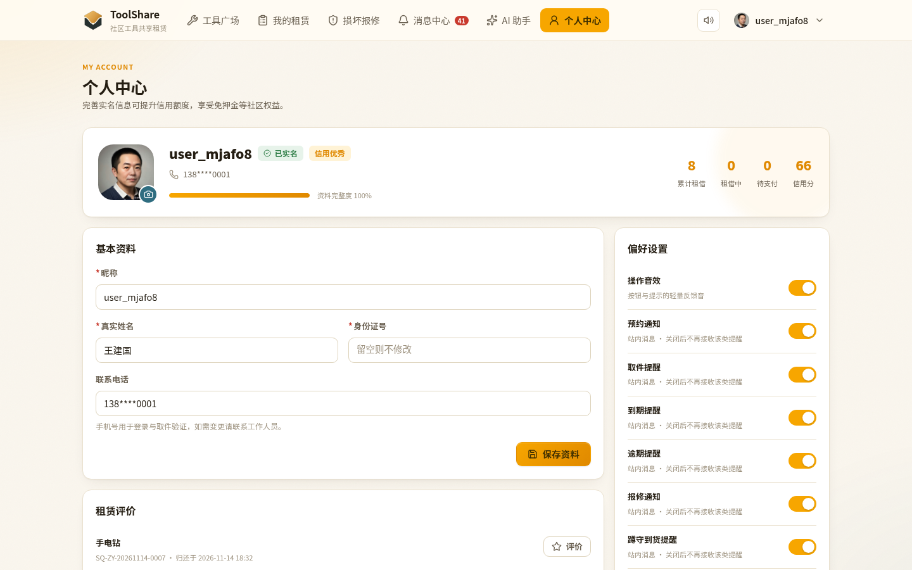

> 身份证号保存后只展示脱敏值；如需修改手机号，请联系社区工作人员。

### 2.10 评价与信用分

1. 在个人中心找到已归还租赁单，点击「评价」。
2. 选择 1–5 星，填写评价内容，可上传最多 3 张图片。
3. 提交后不可修改，评分会进入工具评分与推荐排序。
4. 信用分按履约事件变化：按时归还 `+2`、逾期 `-3`、严重损坏 `-10`、收到 ≤2 星评价 `-5`。

## 3. 管理端操作

### 3.1 登录

1. 打开 `http://localhost:5902/login`。
2. 输入管理员账号与密码。
3. 点击「启动控制台」，进入仪表盘。

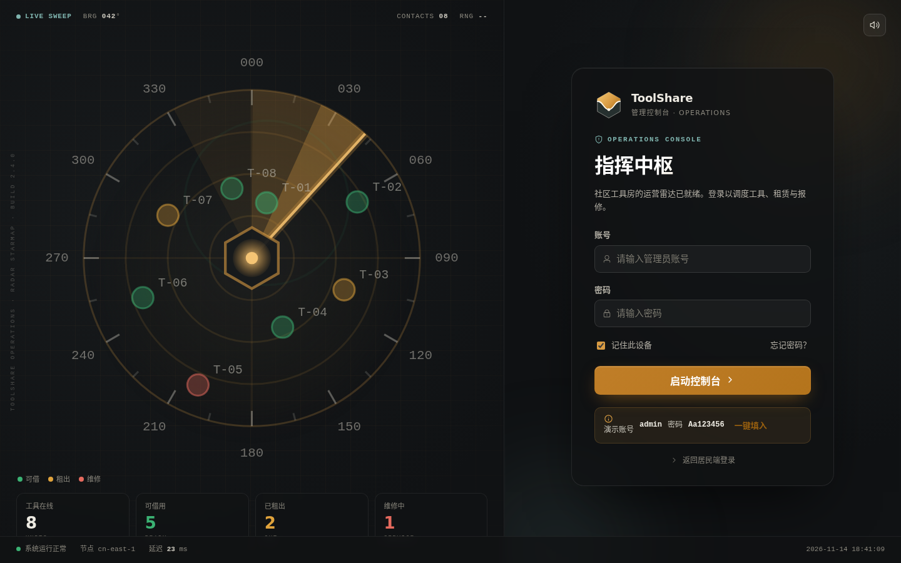

工作人员账号由系统管理员在「管理员账号」中创建并分配 `STAFF` 角色。

### 3.2 仪表盘

仪表盘展示工具总数、活跃租赁、逾期预警、待处理报修、近 7 日租赁趋势、工具状态分布、待办事项、分类工具数量与最近动态。

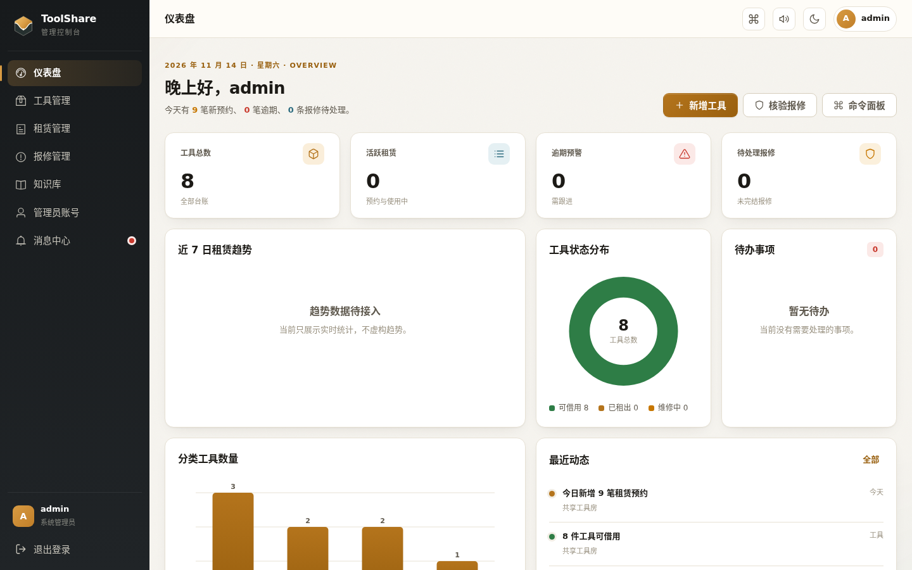

> 统计口径来自真实业务表；没有数据时显示 0，不虚构趋势。

### 3.3 工具管理

系统管理员可新增、编辑、审核、停用、恢复和查看工具历史日志。

1. 进入「工具管理」，使用搜索、类别、状态、存放区域、维修时间筛选。
2. 点击「新增工具」录入名称、型号、类别、押金、存放区域、使用说明与图片。
3. 新工具默认为待审核；审核通过后才可被居民预约。
4. 对故障工具执行「状态」变更（维修中/报废/恢复可借），系统记录日志。
5. 点击「历史租赁」查看该工具的历史记录。

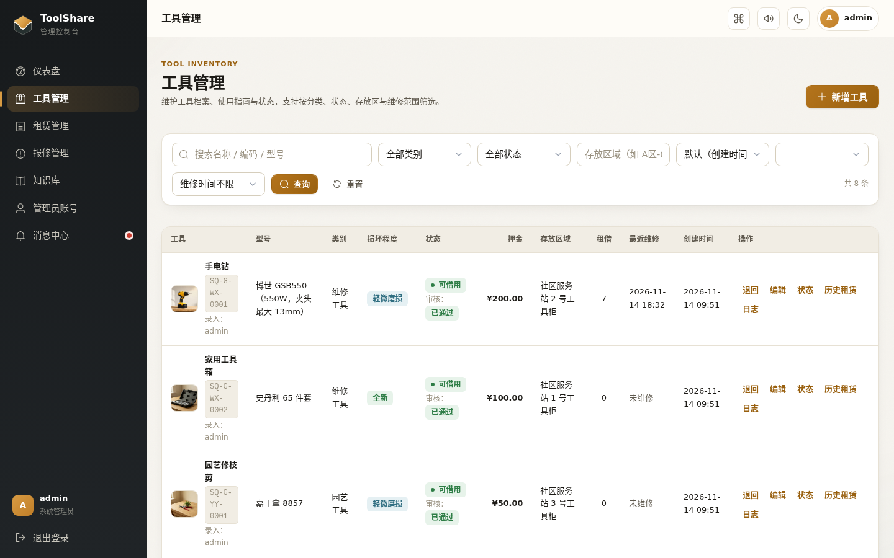

### 3.4 租赁管理

工作人员可查询全部租赁单、确认取件、归还验收、取消租赁与导出 Excel。

1. 进入「租赁管理」，按单号、工具、租用人、状态、逾期状态、验收结果筛选。
2. 点击「详情」查看租赁单、费用明细与支付流水。
3. 居民取件时点击「取件」确认，租赁单进入「使用中」。
4. 居民归还时点击「归还」，登记验收结果、备注、减免原因，系统计算逾期费、赔偿与退款。
5. 点击「导出 Excel」导出当前筛选结果。

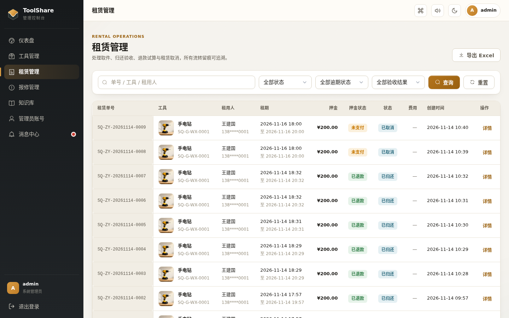

### 3.5 报修管理

1. 进入「报修管理」，查看已提交、已核验、维修中、已完成报修单。
2. 对「已提交」报修进行核验：确认损坏或驳回，并记录原因。
3. 确认后登记维修负责人、预计时间、维修说明与费用。
4. 维修完成后验收：合格恢复工具、不合格继续维修、无法修复则报废。
5. 居民可在居民端同步查看报修进度。

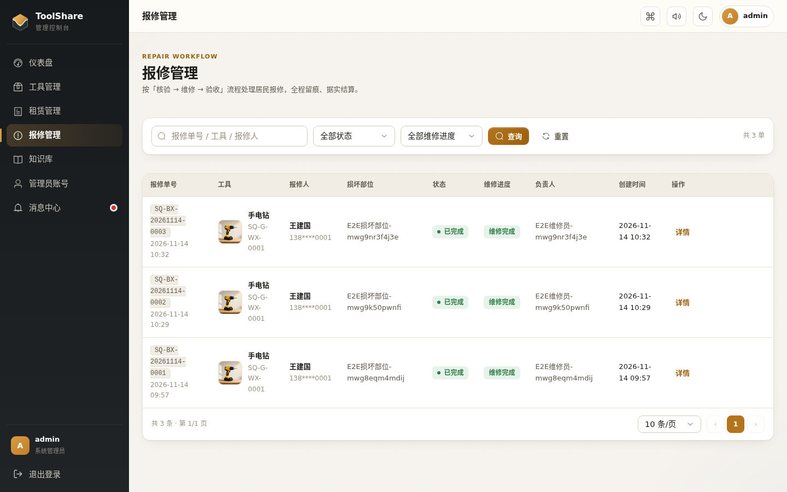

### 3.6 知识库

系统管理员可上传知识库文档，系统解析正文、切块并建立向量索引。

1. 进入「知识库」，查看文档总数、已索引、索引失败与本周新增。
2. 点击「上传文档」，选择 txt/md/pdf/docx 文件并填写标题。
3. 上传后可查看索引状态；失败时系统会定时重试。
4. 点击「预览」查看正文片段；点击「删除」同时清理向量索引。

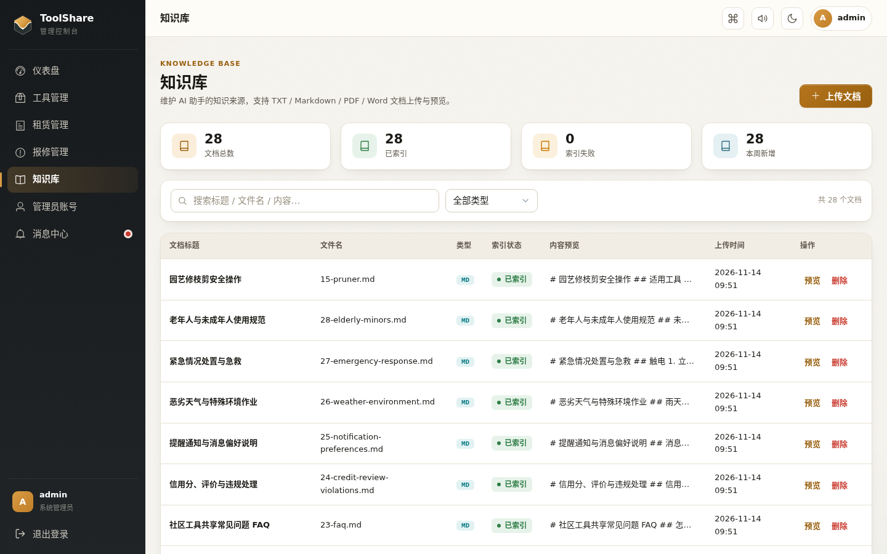

### 3.7 消息中心

管理端消息中心展示预约、取件、逾期、报修、维修完成等通知，可按类型筛选并标记已读。

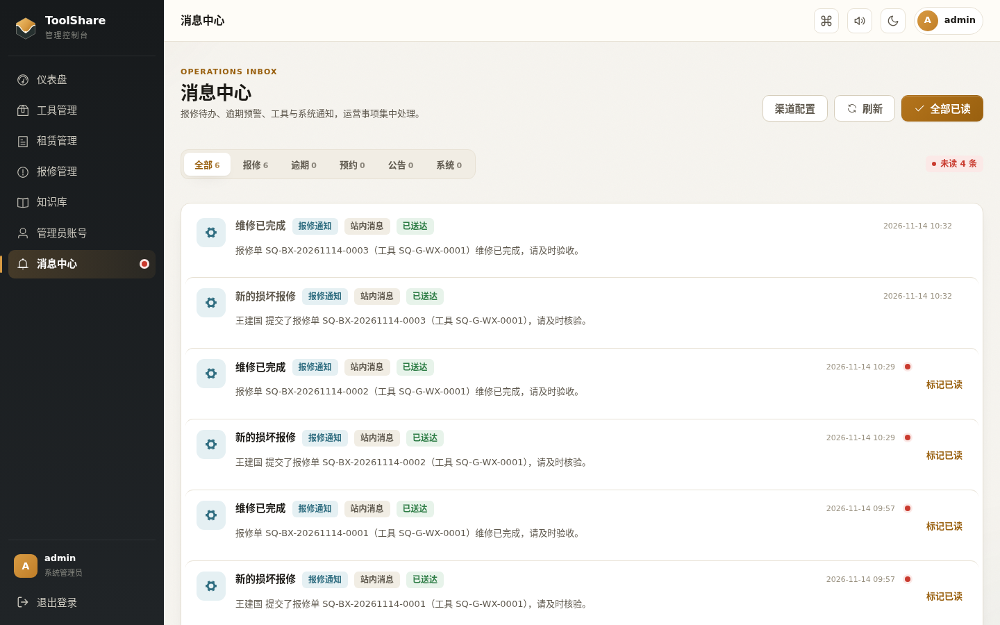

### 3.8 管理员账号

系统管理员可查看管理员列表并分配角色。

1. 进入「管理员账号」查看账号、角色、状态。
2. 新增工作人员账号并分配 `STAFF` 角色。
3. 修改角色后权限立即生效；工作人员不能访问系统管理员专属接口。

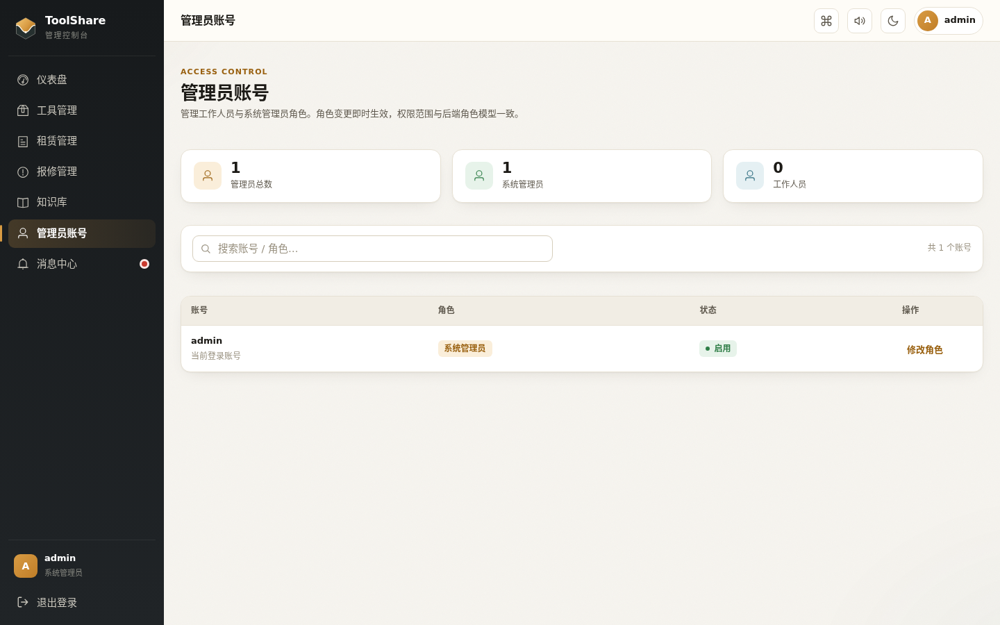

## 4. 常见问题

| 现象 | 处理方式 |
| --- | --- |
| 登录提示验证码错误 | 确认验证码未过期；演示环境查看页面提示或后端日志 `[MOCK SMS]` |
| 预约提示时段冲突 | 调整时间或选择系统建议的开始时间 |
| 无法取消租赁 | 取件前不足 24 小时请联系工作人员 |
| 无法预约工具 | 检查是否完成实名、工具是否已审核且状态可借 |
| 图片不显示 | 检查 MinIO 是否启动、`MINIO_PUBLIC_ENDPOINT` 是否浏览器可达 |
| AI 回答没有来源 | 知识库可能未索引完成；等待重试或检查 Ollama/Qdrant |
| AI 回答为兜底内容 | DeepSeek 不可用或超时；系统已降级，不影响租赁流程 |

## 5. 退出登录

点击右上角用户菜单，选择「退出登录」。管理端与居民端分别注销各自的会话，token 不互通。
